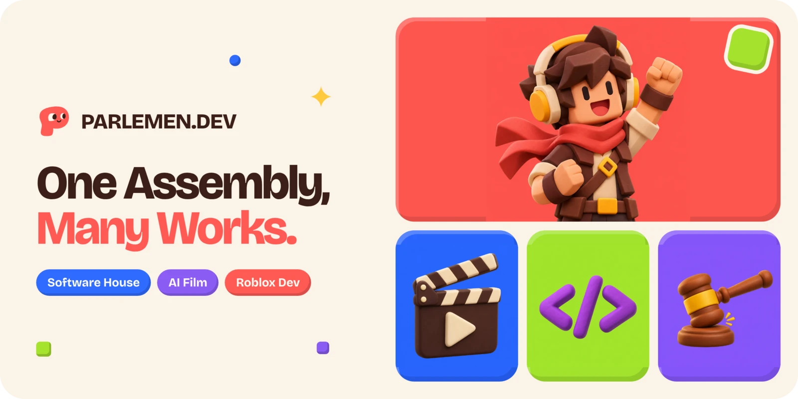
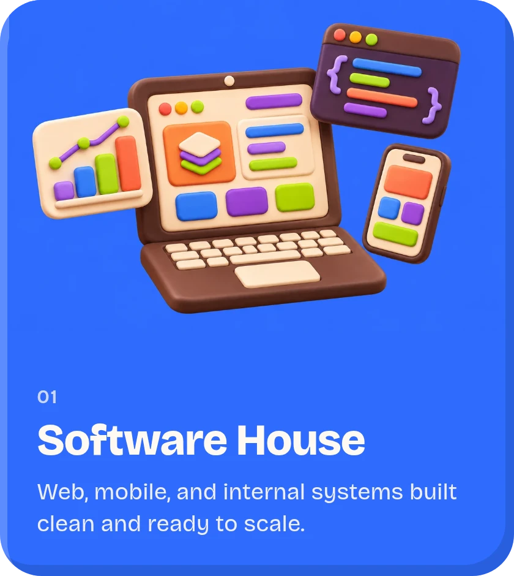
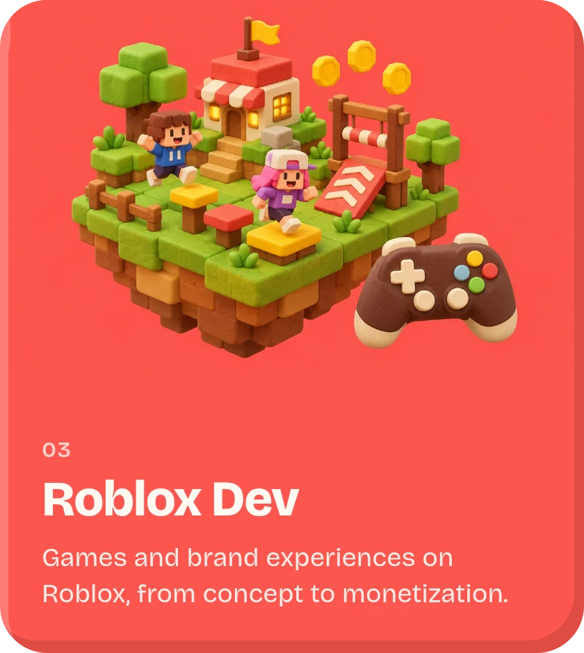
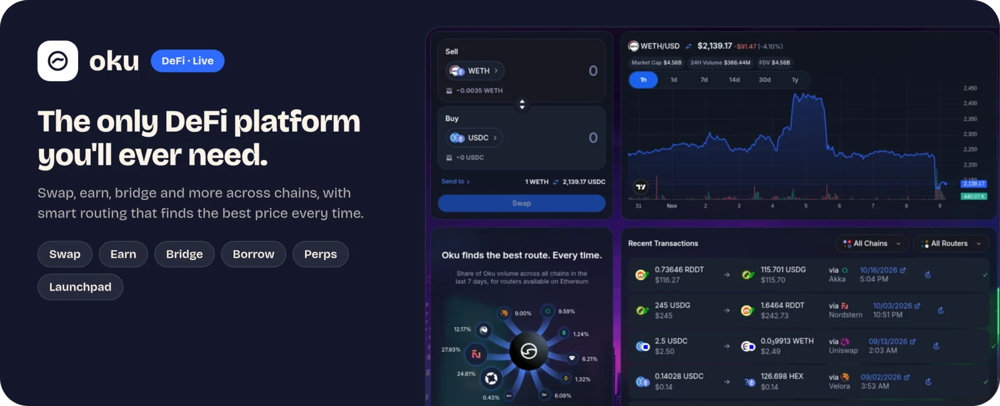
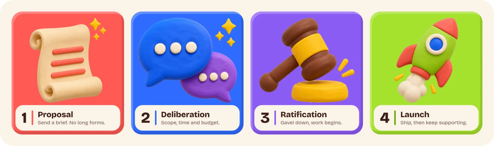
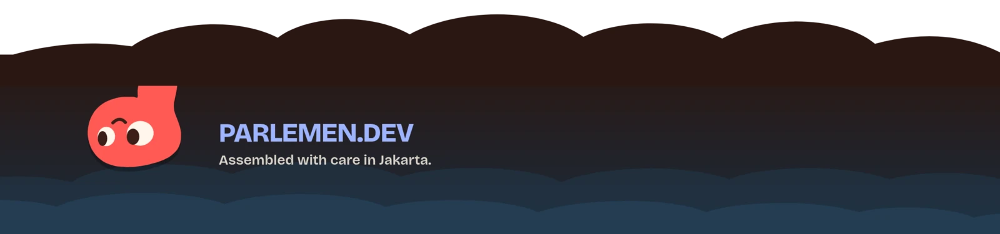

  

<h3 align="center">A multi-discipline creative studio from Jakarta.</h3>

  Software, AI film and Roblox games under one roof. Each <b>faction</b> is expert in its craft, 
  and they sit in session together for every project.

  
  
  

 

## Our Factions

  
  
  

 

## Products

  

<a href="https://oku.trade"><b>oku.trade</b></a> &nbsp;·&nbsp; Swap, earn, bridge and more across chains.

 

## Rules of Session

  

 

## Got a proposal?

Let's put it to session. Write to **[halo@parlemen.dev](mailto:halo@parlemen.dev)** or visit **[parlemen.dev](https://parlemen.dev)**.

  

